# HedgeRow - Player's Manual

*A Nine Lives Software game. Designed by Pieter De Villiers.*

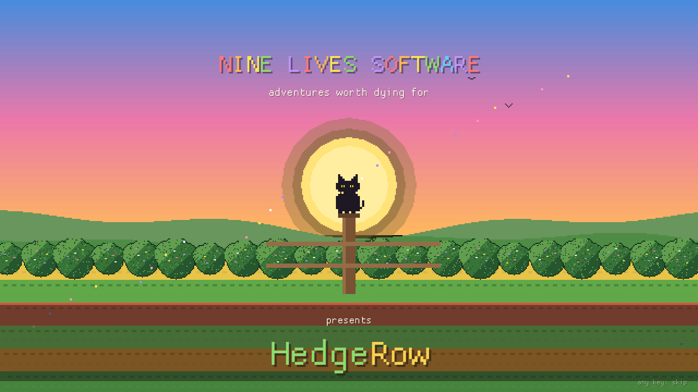

> This manual explains how everything works. For a plan that wins a season, see
> [WALKTHROUGH.md](WALKTHROUGH.md).

*This is a work of fiction. The countryside in this game is imaginary, the clover is a
made-up currency, and Nine Lives Software is this game's own studio name. Any resemblance to
actual persons, places or events is purely coincidental.*

---

## The farm

You have a field, a farmhouse, a barn, a coop with six hens, a dog, and **30 days**. You
start with **2,000 clovers**. Plant, water, harvest and sell, and end the season with more
than you started with.

Nature doesn't make it easy. **Crows** come for your ripe crops, a **fox** comes at night for
your hens, and **hail** falls on the fields. You don't fight nature: you **protect** the farm.
You can scare things off, fence them out, or cover your crops - and every way of doing it
costs something.

At the end of the season the farm gets a **rating**. It counts the money you made, and how
well you treated the land.

---

## Starting

The game opens with the studio's splash. Any key or click skips it. Then you're on the farm,
on the morning of day 1.

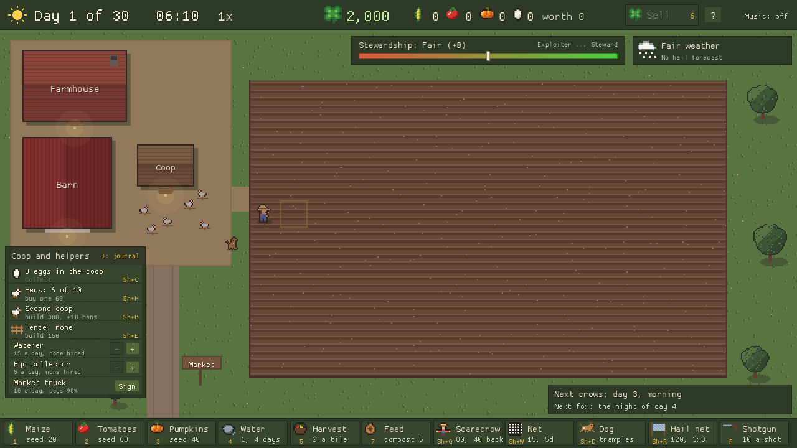

- **Top bar:** the day, the time, the speed, your clovers, what's in the barn and what it's
  worth, the **Sell** button, **?** (About) and the music.
- **Under the top bar:** the **stewardship meter** (Exploiter ... Steward) and the
  **weather card**.
- **Left:** the farmhouse, the barn, the coop and the **Coop and helpers** panel.
- **Middle:** the field, 16 x 10 tiles.
- **Bottom:** the **toolbar**. Every tool is a button, with its key on it.
- **Bottom right:** what's under the mouse, and what's coming next ("Next crows: day 3").

---

## Controls

| Key | What it does |
|---|---|
| Arrows / WASD | Walk the farmer |
| Click a tile | Walk there (no tool picked), or give the farmer a job (tool picked) |
| Click and drag | A job on every tile you cross |
| 1 / 2 / 3 | Maize / tomato / pumpkin seed |
| 4 | Watering can |
| 5 | Harvest |
| 6 | Sell the barn at the market |
| 7 | Feed (press again to change kind: compost, manure, chemical) |
| 8 | Buy an extra day from the bank (from day 28) |
| E or Enter | Use the tool on the tile in front of the farmer |
| Right-click | Put the tool down |
| Backspace | Clear the job list |
| Shift+Q | Scarecrow |
| Shift+W | Net |
| Shift+R | Hail net |
| Shift+D | Send the dog |
| F | Shotgun |
| Shift+E | Build or mend the fence |
| Shift+C | Collect the eggs |
| Shift+H | Buy a hen |
| Shift+B | Build a second coop |
| Space | Pause |
| + / - | Faster / slower (1x, 2x, 4x) |
| J | The farm journal |
| F1 | About |
| M | Music on or off |
| F11 | Full screen |
| Tab | Skip a cutscene |
| Esc | Close what's open, or quit |

The window can be made any size: drag its edges. The farm keeps its shape.

---

## Playing

### The job list

Pick a tool, then click tiles: each click is a **job**, and the farmer walks over and does
them in order. Drag across a row to plant or water it all at once. Each job shows its icon
on its tile. The farmer has to walk, so distance matters: they can't be everywhere at once.

### Crops

| Crop | Seed | Ripe in | Harvest | Price each | Water | Once ripe |
|---|---|---|---|---|---|---|
| Maize | 20 | 12 days | 5 cobs | 16 | Hardy: a dry day costs 8% | Keeps 2 days, then -3% a day |
| Tomatoes | 60 | 7 days | 6 | 25 | Delicate: a dry day costs 25% | Keeps 1 day, then -10% a day |
| Pumpkins | 40 | 10 days | 2 | 60 | A dry day costs 15% | Keeps 2 days, then -3% a day |

- **Water.** A crop only grows on days it has water. A watered tile stays wet for 4 days. A
  new seed is watered in. A **blue drop** means "water me". Water costs **1 clover a tile**.
- **Harvest.** It costs **2 clovers a tile**, and the crop goes into the barn.
- **Soil.** Every tile has a soil number (hover it to see). Good soil gives a bigger harvest.
  Each harvest uses some up; an empty tile slowly gets it back.
- **Too late.** A seed that can't ripen before day 30 shows "too late" on its button.
- Crops still in the ground at the end of the season are lost.

### Selling

Press **6** or the **Sell** button: the farmer walks to the market and sells everything in
the barn. While they're away, nothing gets done on the field. Whatever is still in the barn
on the last day is sold for you.

### Speed and time

A day lasts 20 seconds at 1x. Speed it up with **+** when it's calm. The game drops back to
1x by itself when crows come, the fox comes or hail starts.

---

## Nature fights back

There are **three ways to answer** every threat:

| Way | How fast | What it costs |
|---|---|---|
| **Prevent** (scarecrow, nets, fence, hail nets) | Slow: done in advance | Clovers, and sometimes land or growth |
| **Chase off** (the dog, the farmer) | Quick | Trampled crops |
| **Shoot** | At once | Stewardship, shells, and frightened hens |

### Crows

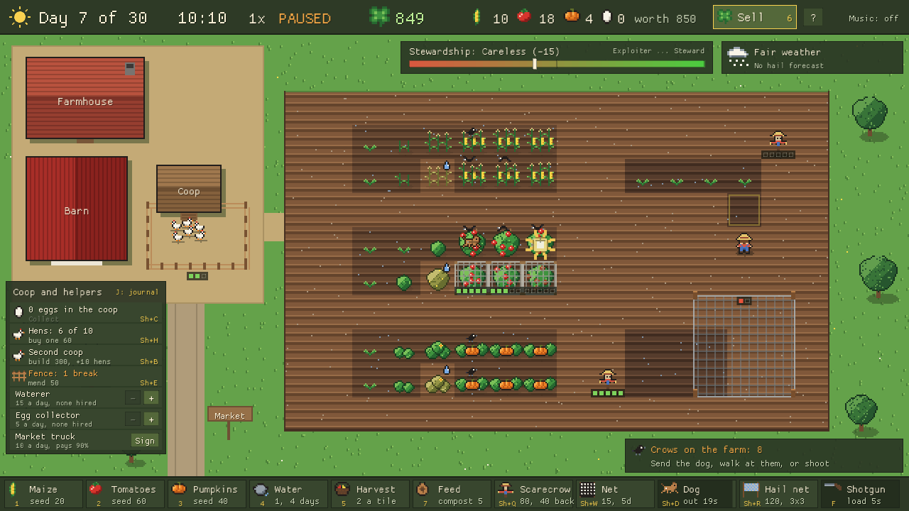

From **day 3**, every second day, a wave of crows comes in the morning for your **ripe**
crops. They like tomatoes best. Each crow pecks a crop six times, taking 5% of its harvest
with each peck. The bottom right says when the next wave is due. Waves grow over the season,
and a field of only one crop gets **bigger waves**.

- **Scarecrow** (80): stands on an empty tile and keeps crows away from everything within 3
  tiles (a ring shows its reach). After **5 days** in one spot the crows get used to it and
  it's **gone**. Pick it up before then (use the scarecrow tool on it) and you get **40
  back**. Put it down somewhere else and it starts again.
- **Net** (15 a tile): crows can't touch a netted tile. But a net shades the crop (it grows
  25% slower), harvesting under it is slower, and it wears out after **5 days**. Taking it
  off gives nothing back. Net what's ripe, when a wave is due.
- **The dog** (Shift+D, then click): runs from the gate to that tile and scatters every crow
  near it. Free, but it **tramples** every crop on its way. It needs 20 seconds' rest after
  each run.
- **The farmer:** walk onto a tile where crows are eating and they fly off (a little
  trampling).
- **The shotgun** (F, then click): every crow within 3 tiles leaves at once. Each shell
  costs 10, each shot costs **15 stewardship**, and the hens lay no eggs for two days.

### The fox

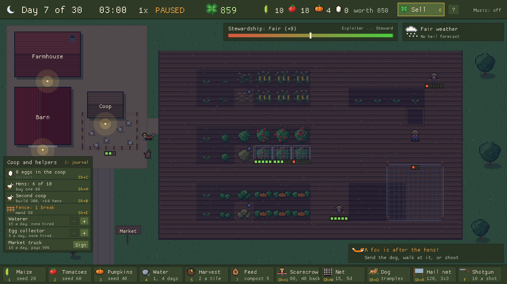

Every **third night**, from day 4, a fox comes for a hen. It crosses the field to the gate
and goes on to the coop. The bottom right says "Fox tonight?" on the day it's due. **A fox
that gets a hen comes back every night** until you turn it away.

- **The fence** (Shift+E, 150): stops the fox. Each visit **breaks** it a little: mending
  costs **50** after one break and **75** after two. The third break and the fence is
  **gone** (it held that night). Then you need a new one.
- **The dog**, or **the farmer** standing in its way, turns it back for the night.
- **The shotgun** sends it away for good, but costs **25 stewardship**.

### Hail

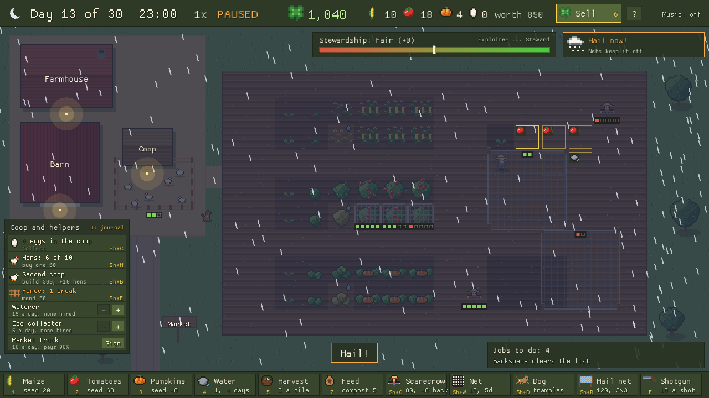

Twice a season hail is **forecast 3 days ahead** on the weather card. It falls at 22:00
that night. Every crop not under cover loses part of its harvest: pumpkins 60%, tomatoes
40%, maize 25%.

- **Hail net** (Shift+R, 120): goes up over 3 x 3 tiles, on posts. It doesn't take a tile
  or shade the crop. Take it down for **60 back**. **Two storms tear it** and it's gone.
- A crow **net** also keeps hail off its own tile.

### How much is left: the dots

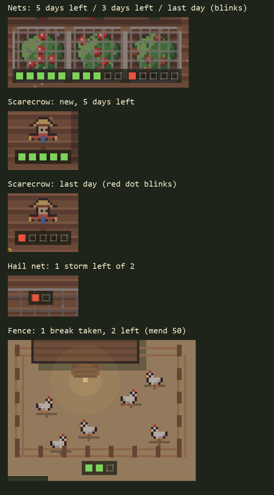

Every defence that wears out shows a row of dots: one for each **day** (nets,
scarecrows), **storm** (hail nets) or **break** (fences) it has left. Green, then yellow
from half way, then red for the last one. On a net's or a scarecrow's last day the red dot
blinks. When the dots are gone, so is the defence.

---

## The stewardship meter

The meter runs from **Exploiter** (-100) through Careless, Fair and Careful to **Steward**
(+100). It moves with how you farm:

| Up | Down |
|---|---|
| +1 each day all three crops are growing | -2 each day the field is mostly one crop |
| +3 each crow wave seen off without a shot (if it ate little) | -15 each shot at crows |
| +3 each fox visit turned away without a shot or a lost hen | -25 a shot at the fox |
| +1 each crop fed with compost | -5 each hen the fox takes |
| | -1 each crop fed with chemicals |

---

## Hens, eggs and helpers

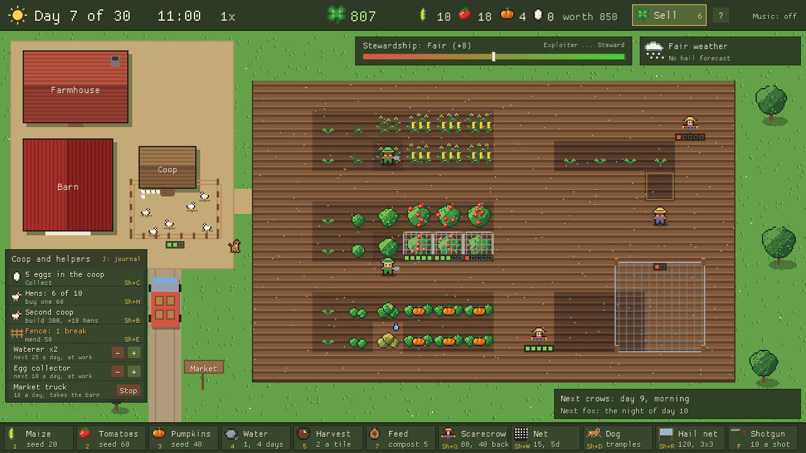

The **Coop and helpers** panel (bottom left) runs the yard.

- **Eggs.** Each hen lays an egg at dawn. Eggs wait in the coop until you **collect** them
  (Shift+C), then sell at the market for 8 each. An egg not collected by the second dawn goes
  bad. A fox in the coop breaks the eggs.
- **More hens** (Shift+H): 60 each, up to 10 a coop. A new hen starts laying after a day.
- **A second coop** (Shift+B): 300, room for 10 more hens. It needs its own fence.
- **Helpers** (+ and - in the panel), up to 4, in daytime only:
  - **Waterer**, 15 a day: waters dry, growing tiles (the water still costs 1). Now and then
    it steps on a crop.
  - **Egg collector**, 5 a day: collects the eggs every morning.
  - A second helper of the same kind costs 5 more a day.
- **The market truck** (10 a day): every second day at 10:00 it takes the whole barn and
  pays **90%** of the market price. The farmer never has to leave the field.

---

## Feeding the crops

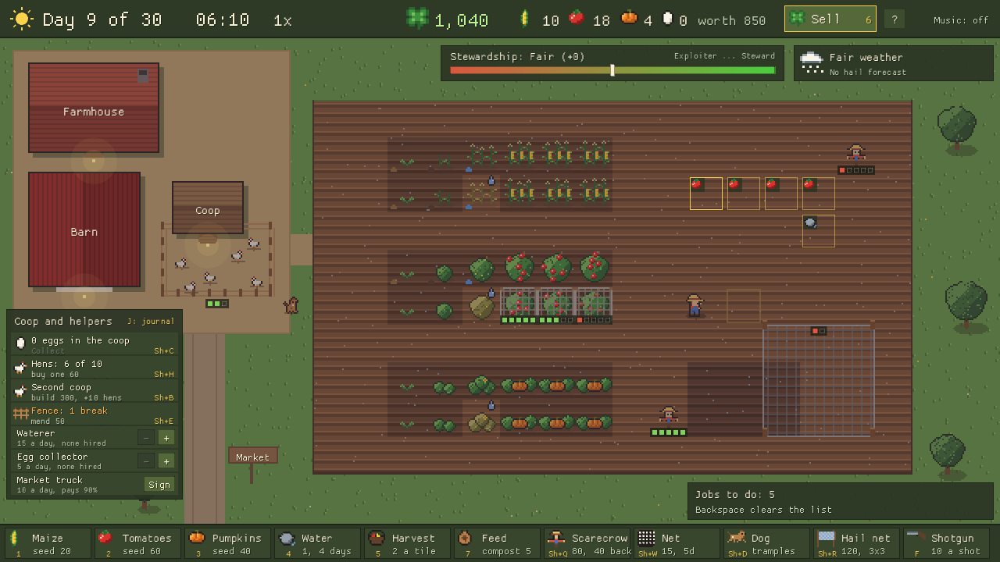

Press **7** (again to change the kind), then click a growing crop. One feed per crop.

| | Compost | Manure | Chemical |
|---|---|---|---|
| Cost | 5 | free, from the hens' heap | 15 |
| Harvest | +10% (pumpkins +20%) | +20% (tomatoes +30%) | +50% (maize +70%) |
| Price | +20% | +10% | -20% |
| Soil | better | a little better | worse |
| Stewardship | +1 | 0 | -1 |

Every hen makes a load of manure a day. Chemical feed draws more crows.

---

## The end of the season

From **day 28**, if crops are still growing, the **bank** offers extra days (key 8). Each
day costs more than the one before, and you can't plant in them. You can buy up to 5.

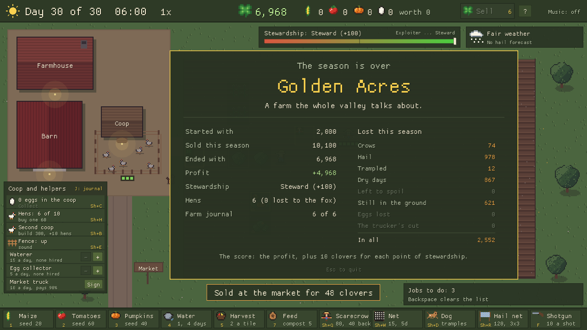

On the last day the barn is sold and the **end report** shows what you made, what was lost
to what, and the farm's **rating**:

| Rating | Score (profit + 10 x stewardship) |
|---|---|
| **Golden Acres** | 5,000 or more |
| **Green and Growing** | 3,000 or more |
| **Getting By** | 1,500 or more |
| **Hard Times** | 0 or more |
| **Dust Bowl** | below 0 |

---

## Firsts and the farm journal

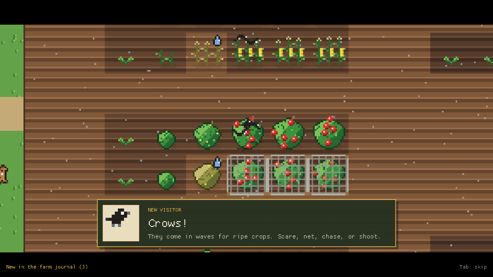

The first time something new happens - the first ripe crop of each kind, the first crows,
the fox, the first hail forecast - the camera eases in for a moment and a card tells you
about it. **Tab** or a click skips it. Each card goes into the **farm journal** (**J**).

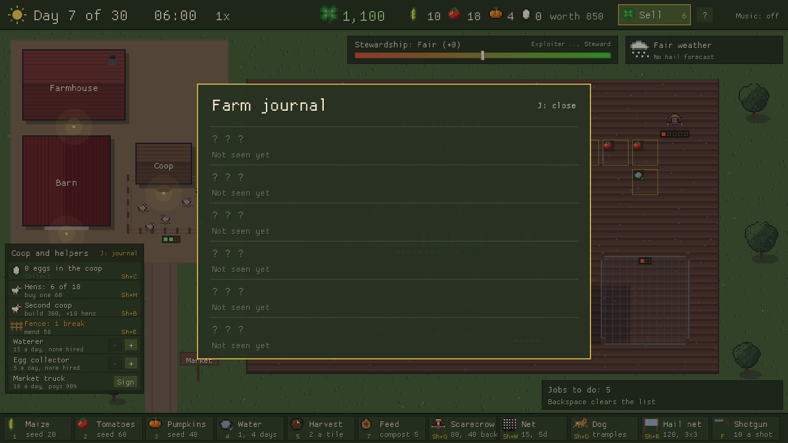

---

## About

**F1** or the **?** on the top bar shows the version, who made the game, and every
version so far.

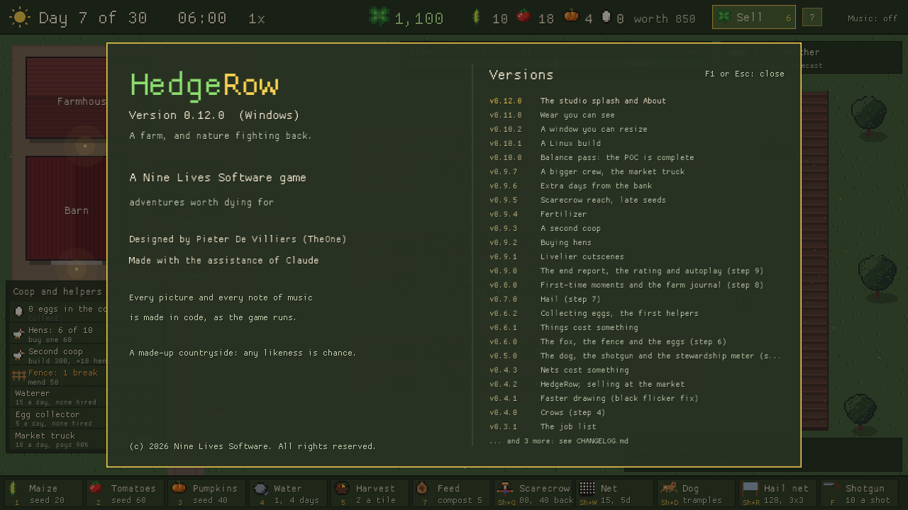

---

## Requirements

- **Windows:** Windows 10 or 11. The download is a single `.exe`: no installer, just run
  it. Windows may warn that it's from an unknown publisher: choose "More info", then
  "Run anyway".
- **Linux:** a desktop from 2022 or later (Ubuntu 22.04, Debian 12, Fedora 35 or newer).
  Unpack and run `./hedgerow`.
- Any graphics card from the last ten years. Sound is optional: with no sound card the game
  plays silently.

---

## Credits

Designed by **Pieter De Villiers** (TheOne). Made with the assistance of Claude.
Every picture and every note of music in HedgeRow is made in code as the game runs.

&copy; 2026 Nine Lives Software. All rights reserved.
