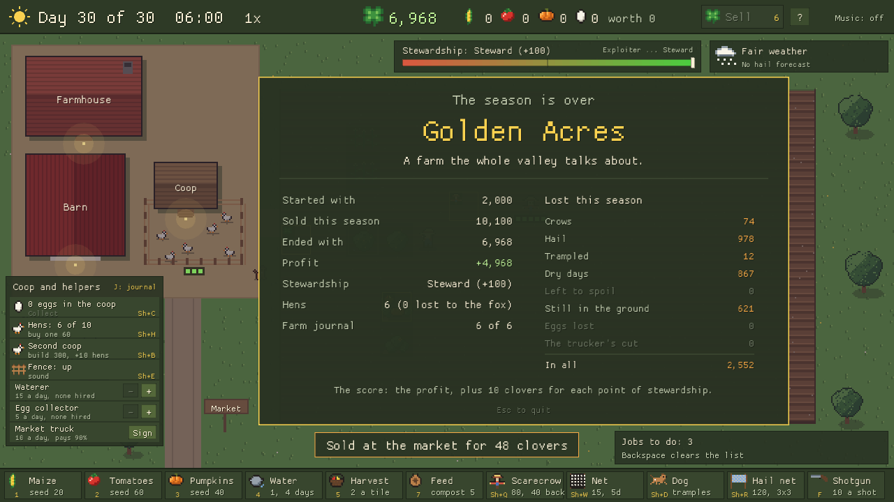

# HedgeRow - Walkthrough

*How to farm a **Golden Acres** season.* For how everything works, see the
[player's manual](MANUAL.md).

> HedgeRow has no single solution: the crows, the fox and the hail land on different days
> in every season. This walkthrough is the plan the game's own **careful** test season
> follows (`--autoplay`), with its real results. It reaches Golden Acres in every one of the
> five test seasons.

## Routes at a glance

Results of the two test seasons over five seeds (v0.12.0):

| Route | Profit (average) | Stewardship | Hens kept | Rating |
|---|---|---|---|---|
| **Careful** (this walkthrough) | **+4,869** | +99 (Steward) | 5-6 of 6 | **Golden Acres** every time |
| Lazy (plant, water, harvest, sell; no defences) | +3,087 | +47 (Careful) | 0 of 6 | Getting By or Green and Growing |

The lazy season loses every hen to the fox, and far more of its crops to the hail. The
careful one spends more on defences and makes about 1,800 more.

---

## The plan in one line

**Plant all three crops, keep them watered, harvest the day they ripen, sell often - and
put each defence up just before it's needed, not long before.**

## 1. The field (day 1)

Plant five rows, leaving room between them to walk and a row free for the scarecrow:

| Row | Columns | Crop | Why |
|---|---|---|---|
| 2 | 3-12 | Maize | Cheap, hardy, worth 80 a tile |
| 3 | 3-12 | Maize | |
| 5 | 3-10 | Tomatoes | The crows' favourite: keep them next to the scarecrow's row |
| 7 | 3-10 | Pumpkins | Worth 120 a tile, but hail hurts them most |
| 8 | 3-10 | Pumpkins | |

(Rows and columns counted from 1 at the top left of the field.)

- Pick a seed, then **drag** along the row: one drag plants it all.
- Keep **150 clovers** back for water and harvesting.
- **Mixed fields** earn stewardship (+1 a day with all three crops growing) and keep the
  crow waves smaller. A field of only one crop costs stewardship every day and brings crow
  waves half as big again.

## 2. Every day: water, harvest, sell

- **Water** anything with a blue drop. Tomatoes lose a quarter of their harvest for each
  dry day, so water them first.
- **Harvest the day a crop ripens**, tomatoes most of all (they rot after one day).
- **Replant** a harvested tile straight away, as long as the seed can still ripen before
  day 30 (the toolbar greys out seeds that can't).
- **Sell** when the barn is worth about 400, but not while crows are on the field: the
  farmer is away for a few seconds.
- **Collect the eggs** in the daytime, before they go bad.

## 3. Crows: a scarecrow that moves (from day 3)

- On **day 3**, put a **scarecrow** in row 4 (between the maize and the tomatoes), at
  column 6. Its 3-tile ring covers most of the tomatoes.
- On its **4th day** (one dot left, red and blinking), **pick it up**
  (40 back) and put a new one down at column 8. Then back to column 6 four days later, and
  so on. Never let it run out: a scarecrow the crows get used to is gone, with nothing back.
- When crows do land on something, **send the dog** (Shift+D) at the ones that are eating.
  Send it along rows that are empty or already harvested where you can: it tramples
  whatever it runs over.
- Don't shoot. A shot costs 15 stewardship, and the hens stop laying for two days.

## 4. The fox: a fence, kept mended (from day 3)

- Build the **fence** (Shift+E, 150) on day 3, before the first fox on the night of day 4.
- After each visit it has taken a break (the dots under the run): **mend it the next day**
  while it's cheap - 50 after one break, 75 after two. Let it take a third and you pay
  150 for a new one.
- If a fox comes when the fence is down, **send the dog** at it. Losing one hen means the
  fox comes back every night until you turn it away.

## 5. Hail: nets up only when it's forecast

- When the weather card says **"Hail likely on day N"**, put up three **hail nets**
  (Shift+R) over the pumpkins: centred on row 7, at columns 4, 7 and 10. Together they
  cover rows 6 to 8, columns 3 to 11: both pumpkin rows. Maize loses least to hail, so it
  goes without.
- **Take them down the morning after the storm** (60 back each). A net left up through
  both storms is torn and lost.

## 6. Feed

- Each hen makes a load of **manure** a day: feed it to the **tomatoes** (+30% harvest).
- Feed **compost** (5) to the **pumpkins** (+20% harvest, +20% price, better soil,
  +1 stewardship each).
- Skip chemical feed: it pays now, but it lowers the soil, the price and the stewardship,
  and it draws more crows.

## 7. The last days

- From about day 18, plant only what can still ripen (maize won't after day 18, pumpkins
  after day 20, tomatoes after day 23, if watered every day).
- On **day 29**, sell everything in the barn.
- If valuable crops are a day or two from ripe on day 28, the **bank** sells extra days
  (key 8). Worth it for a row of pumpkins; not for a few tomatoes.

---

## Common mistakes

| Mistake | What it costs | Instead |
|---|---|---|
| No fence | Every hen, one a night once the fox has had one | Fence by day 3; mend after each visit |
| Netting the whole field against crows | 25% slower growth, 15 a tile every 5 days | Scarecrow plus the dog; nets only on ripe tiles when a wave is due |
| Hail nets left up all season | 60 back lost on each | Up when forecast, down the morning after |
| A scarecrow left to run out | 40 back lost, and a crow-free tile turned into a feast | Move it on its 4th day |
| One crop everywhere | -2 stewardship a day, 50% bigger waves | All three crops |
| Shooting | -15 stewardship a shot (-25 at the fox), no eggs for two days | The dog, the farmer, a fence |
| Selling with crows on the field | The farmer's away while they eat | Sell after the wave |

---

## Want more?

- Try a season with **helpers**: two waterers and the market truck let you spend your time on
  defence instead of chores - but they cost 45 a day.
- Try for **Steward** (+50 stewardship or more) and **Golden Acres** together without the dog:
  the scarecrow, the fence and the farmer only.
