# NOIR: The Midnight Ledger - Player's Manual

*A Nine Lives Software game. Designed by Pieter De Villiers.*

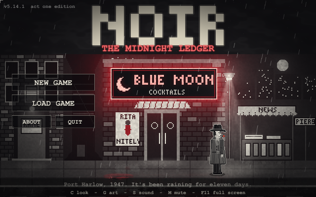

> This manual is spoiler-free. For the full solution see [WALKTHROUGH.md](WALKTHROUGH.md).

*This is a work of fiction. Names, characters, businesses, places, events and incidents are either the products of the author's imagination or used in a fictitious manner. Any resemblance to actual persons, living or dead, or to actual events is purely coincidental. Port Harlow is an imaginary city, and Nine Lives Software is this game's own studio name.*

---

## The story so far

Port Harlow, 1947. It has been raining for eleven days straight.

Last night they fished your partner, Eddie Walsh, out of the harbor. The police
wrote it up as an accident. Funny thing: Eddie couldn't swim, so he never went
near the water.

You are **Sam Kane**, private investigator. Forty-one years old and every one of
them shows. The cops want you to leave it alone. You don't do that.

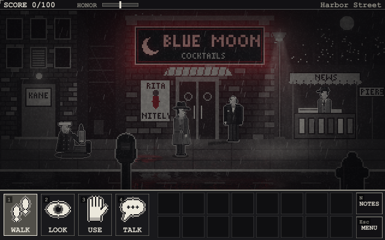

---

## Starting a game

The game opens with the studio's intro and, with the polished art, a short story of how it
all began - click or press any key to skip either.

| The studio | The story so far |
|---|---|
| 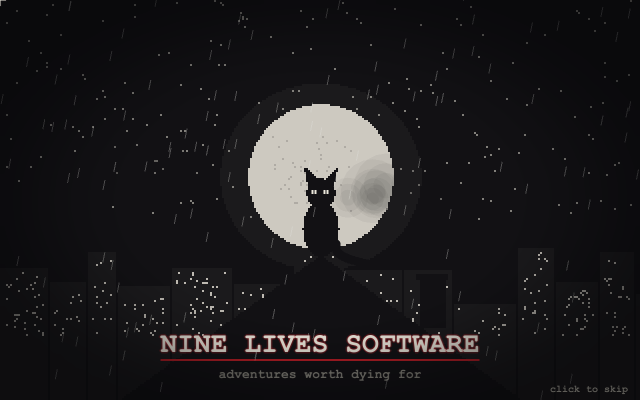 | 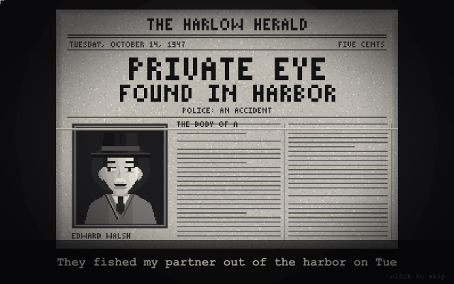 |

On the title screen:

- **NEW GAME** asks for a difficulty (**Easy / Normal / Hard** - see *Difficulty* below);
  then **BEGIN THE CASE**: find out who killed Eddie. Seven locations, 100 points.
- **CONTINUE** picks up from the autosave (made every time you enter a room).
- **LOAD GAME** opens your ten save slots.
- **ABOUT** shows who made the game, and the end credits.
- **QUIT** closes the game (in the browser, just close the tab). (In the middle of a game, Esc opens the menu, which can take you
  back to the title.)

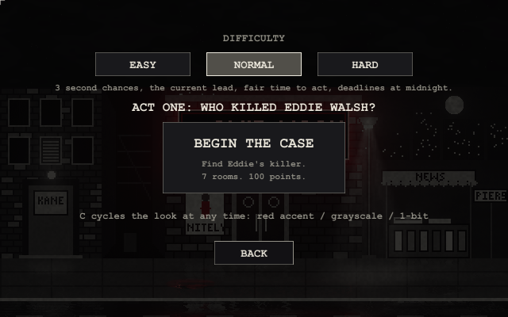

---

## Playing

### The four verbs

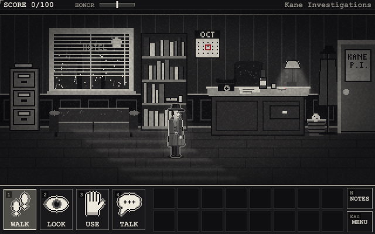

Pick a verb at the bottom left (or press **1-4**, **Q** or right-click to cycle), then
click something in the scene. The little labels on the buttons are their keys.

| Verb | What it does |
|---|---|
| **WALK** | Walk somewhere, or through a door. |
| **LOOK** | Look at something. Look at everything - details matter. |
| **USE** | Pick up, open, push, pull, operate. On a *person* it means your fists. |
| **TALK** | Talk to someone. Many people open a menu of topics to ask about. |

Hover over anything to see its name. **Hold TAB** to label everything you can
interact with in the room. **Double-click** an exit to go straight through it.

### Your inventory

Click an item to hold it, then click where to use it: something in the scene,
another item (to combine them), or Kane himself. **Esc** puts it back. With
LOOK or TALK selected, clicking an item examines it (or talks to it - it's a
lonely job).

### Conversations

Text types itself out; click, **Space** or **Enter** shows it all, and again to
continue. When someone has more to say, a menu of topics appears - click one or
press its number. Ask everyone everything: people say more than they mean to.
With the polished art (**G**), the speaker's mouth moves while their line types out.

| Someone talking | A topic menu |
|---|---|
| 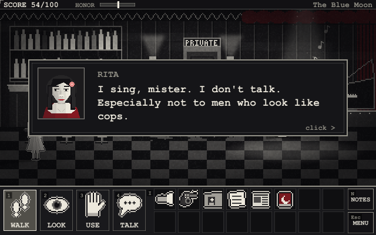 | 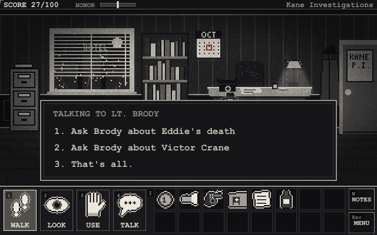 |

### The case notebook

Press **N** (or click **NOTES**) to open your notebook. Every clue you find is
pinned to the board, with red string between the ones that belong together. The
**Current Lead** tells you what a good detective would look into next - if you're
stuck, start there.

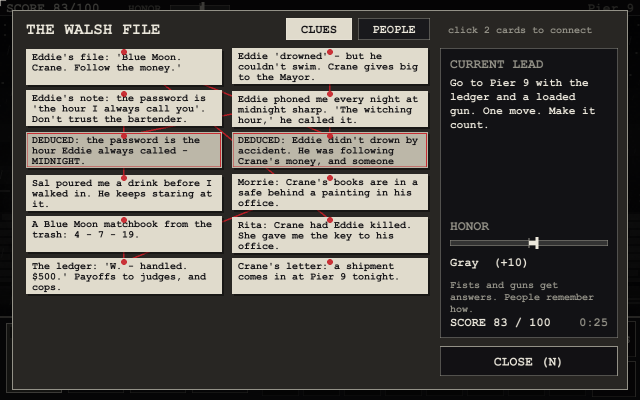

The notebook has a second page, **PEOPLE** (click the tab at the top): everyone who's told you
something - their face, who they are, and what they said, the latest first. People lie, so put
what they said side by side and look for what doesn't fit.

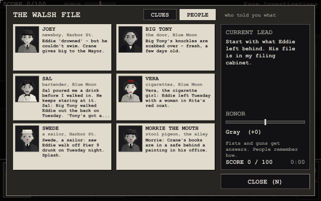

### Deductions

Some answers aren't found - they're **worked out**. Click one card in the notebook,
then another, to connect them. If they add up, Kane pins a new card marked
*deduced* (and you often score points); if they don't, he tells you so. Some
deductions are the only way forward: nobody is going to hand you the password to
the Blue Moon.

### Not every clue is true

People lie. Evidence gets planted. The notebook can't tell a true card from a false
one - and two false cards can add up to a deduction that feels exactly as solid
as a real one. Act on a wrong conclusion and Port Harlow lets you: you can follow a
false lead somewhere you shouldn't be, or accuse the wrong person. Some of those
mistakes end the story - with the wrong man behind bars and the right one still
out there. On **Easy**, Kane's gut puts a **?** on cards that smell wrong.

Port Harlow is full of people with something to say. Some of them know the truth. Some
think they do. Some are paid to think otherwise. A drunk will swear to anything; a friendly
cop may be friendly for a reason. When a story sounds too neat, look for the detail that
doesn't fit - there usually is one.

---

## The honor meter

Some people won't tell you anything. You can be patient, or you can make them talk.

- **USE** on a person roughs them up.
- **Hold your revolver** over someone to pull it on them. Do it again and you fire.

Most people will talk either way. But the meter at the top of the screen
remembers how you got your answers, and so does Port Harlow: some people won't
help a man with a reputation, and how the story ends depends on who you've
become. People remember, too: who you hurt, and how you got your answers, can come back to you
later in the story. Some people Kane simply won't touch - and some are very bad ideas
to try it on.

| Honor | You are |
|---|---|
| 50 and up | Straight arrow |
| 15 to 49 | Decent |
| -14 to 14 | Gray |
| -49 to -15 | Tarnished |
| -50 and below | Crooked |

---

## Time, standoffs and health

**Standoffs.** When someone has a gun on Kane, a red **DRAW!** bar counts down and a
clock ticks. Do the right thing before it runs out, or you're shot. Everything you
do in that moment costs time - loading the revolver under fire takes four seconds
you may not have, and trying to talk your way out gets you an answer but costs two.
Usually there's more than one way out. Usually.

**Deadlines.** At certain points the night is against you: a clock appears in the
corner, counting to midnight. It only runs while you're playing (not while you
read). Miss it and things start to go wrong - and Kane starts to wear down.

**Health.** After a deadline passes, and in some fights, Kane loses health; the
edges of the screen go dark red as it drops. At zero he's done for. A nap on his
office couch helps, but costs time.

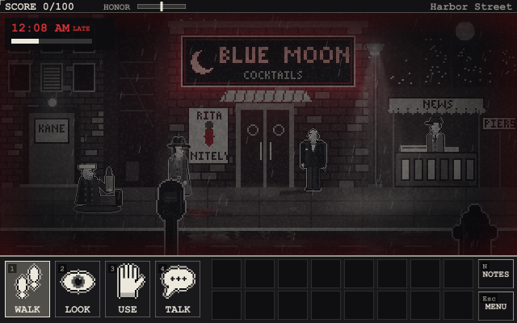

---

## Difficulty

| | Easy | Normal | Hard |
|---|---|---|---|
| Second chances | 5 | 3 | 1 |
| Time to act in a standoff | long | fair | short |
| Deadlines | none | at midnight | tight |
| Current lead in the notebook | yes, plus a gut feeling | yes | no |
| "?" on doubtful clues | yes | no | no |
| TAB labels | yes | yes | no |

---

## Dying (and not quite)

This is a Sierra-style adventure: there are plenty of ways to die, and you will.
When you do, you can:

- **TRY AGAIN** - back to the moment you entered the room.
- **SECOND CHANCE** - Kane has a few per game (three on Normal). In some situations he survives
  after all and you're put back a moment before it happened. Whether it's
  available depends on what you're carrying and how you've treated people; the
  death screen tells you if it isn't, and sometimes why.
- **LOAD** a saved game, or **RESTART**.

| No second chance this time | A second chance |
|---|---|
| 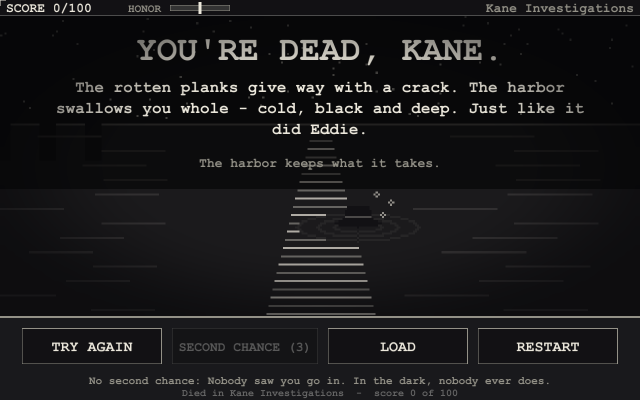 | 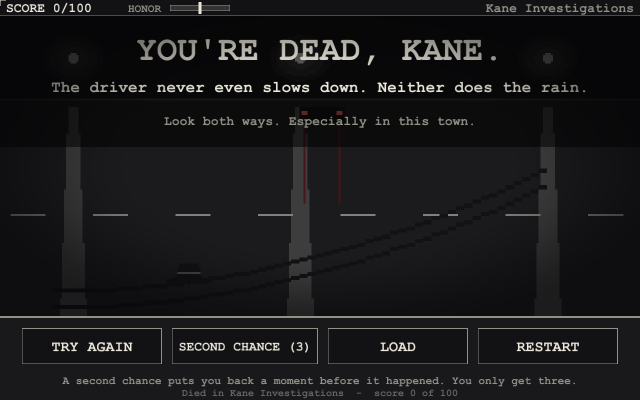 |

---

## The menu and settings

Press **Esc** (or click **MENU**) at any time to pause. The menu shows the version
and who made the game, and lets you save, load, open the notebook, change settings
or quit to the title screen.

| The menu | Settings |
|---|---|
| 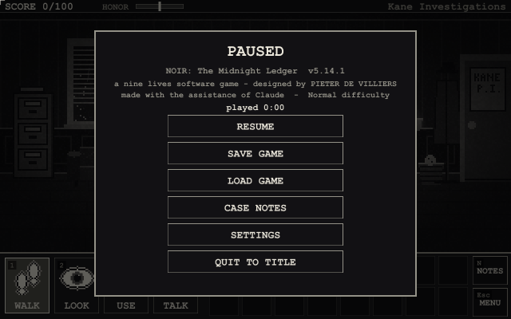 | 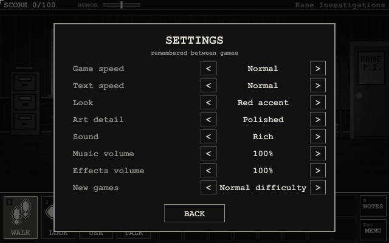 |

**Settings** are remembered between games: game speed (slow to very fast), text
speed (up to instant), the look, the art detail, the sound, music and effects volume, and
the difficulty for new games.

---

## Saving

The game keeps your **play time**: it's in the pause menu, in the notebook next to your score,
on each saved game and at the end (with how long act one took). The menus don't count.

**F5** saves (ten slots), **F7** loads - or use the menu. The game also autosaves
every time you enter a room. You can't save while a gun is pointed at you.

Every saved game has **RENAME** and **DELETE** buttons. Rename lets you type a name
(up to 18 letters; Enter keeps it, Esc cancels) - it stays when you save over that slot
again. Delete asks before it throws anything away.

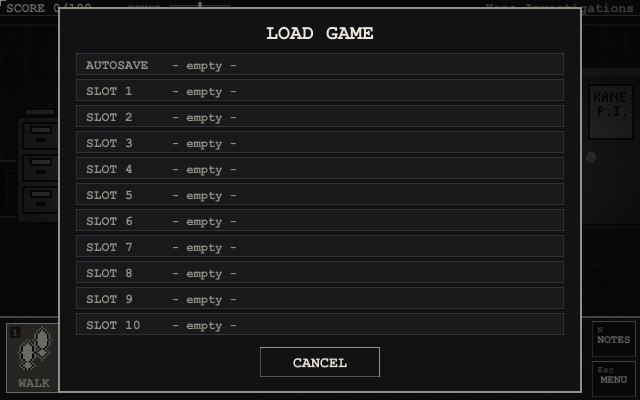

Saves live in `%APPDATA%\NoirMidnightLedger\` on Windows (`./saves` elsewhere). In the browser
they stay in that browser (clearing its site data deletes them).

---

## Looks

Press **C** at any time to switch how the game looks:

1. **Red accent** (default) - black and white, with red only on what matters.
2. **Grayscale** - pure film-noir gray.
3. **Classic 1-bit** - dithered black and white, like the very first version.

| Red accent | Grayscale | Classic 1-bit |
|---|---|---|
|  | 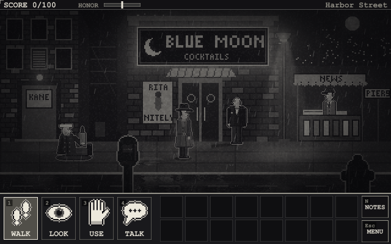 | 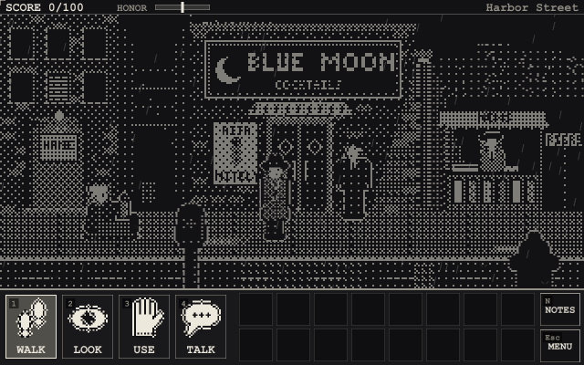 |

Press **G** to switch the **art detail**: *polished* (the default - finer pictures with soft
light, glowing neon, wet streets that mirror the lights, and more detailed people whose faces
show how they feel) or *v4*, the art as it was before. The 1-bit look always uses the v4 art.

| Polished | v4 |
|---|---|
|  | 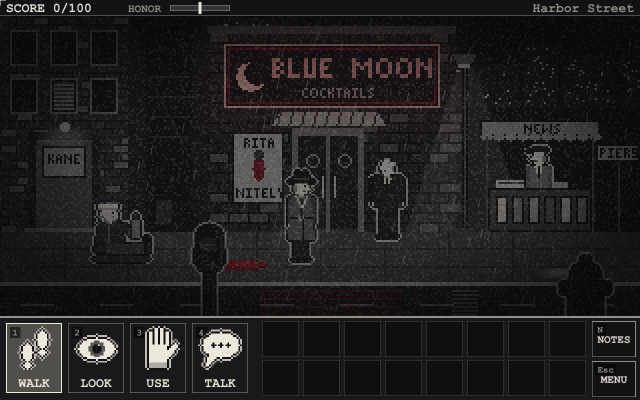 |

Press **S** to switch the **sound**: *rich* (the default - stereo, fuller instruments,
footsteps, and the sounds of the city: traffic, a far-off siren, a radiator, a humming bulb) or
*classic*.

---

## Keys

You can play with the mouse, the keyboard, or both - the whole game works without a mouse.

| Key | |
|---|---|
| Arrow keys | Walk. Walk into a way out (a door, the edge of the street) to go through it |
| Enter / E | Do what your verb says to the nearest thing (WALK on something just looks at it) |
| TAB + left / right | Pick something in the room (it lights up), then Enter / E to act on it |
| I | Take the next thing from your pockets (again for the next one; after the last, back to WALK) |
| 1-4 | WALK / LOOK / USE / TALK (or pick a topic in a conversation) |
| Q / Shift + Q | Next / previous verb |
| Right-click | Cycle verbs; skip text |
| Space / Enter / click | Show all text; continue |
| TAB (hold) | Label every hotspot (not on Hard) |
| N | Case notebook |
| Esc | Drop held item; leave a conversation; close a menu; otherwise open the menu |
| F5 / F7 | Save / load |
| C | Cycle the look |
| G | Art detail: polished / v4 |
| S | Sound: rich / classic |
| M | Mute |
| F11 | Fullscreen |

---

## A private eye's tips

1. **Save early and often.** Port Harlow is not a forgiving town.
2. **Look at everything.** Twice, if it looks back.
3. **Talk to everyone, and ask about everything.** Then ask again later.
4. **Read what you pick up.** LOOK at items in your inventory.
5. **If you're stuck, open the notebook.** The current lead is always honest -
   and connecting cards is how detectives think.
6. **Don't believe everything you're told.** Especially by a man you've just hit.
7. **Watch the clock.** Midnight comes for everyone in Port Harlow.
8. **Think before you pull a gun** - but don't think too long. Not everyone deserves
   it, and some people are faster than they look.

---

## Credits

Finish the story and the credits roll by themselves (or play them from the About screen).
They end with your score. (Rumour has it a certain name, typed at the very end, makes them
tell you what you missed.)

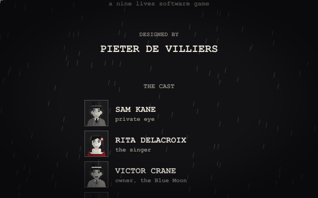
